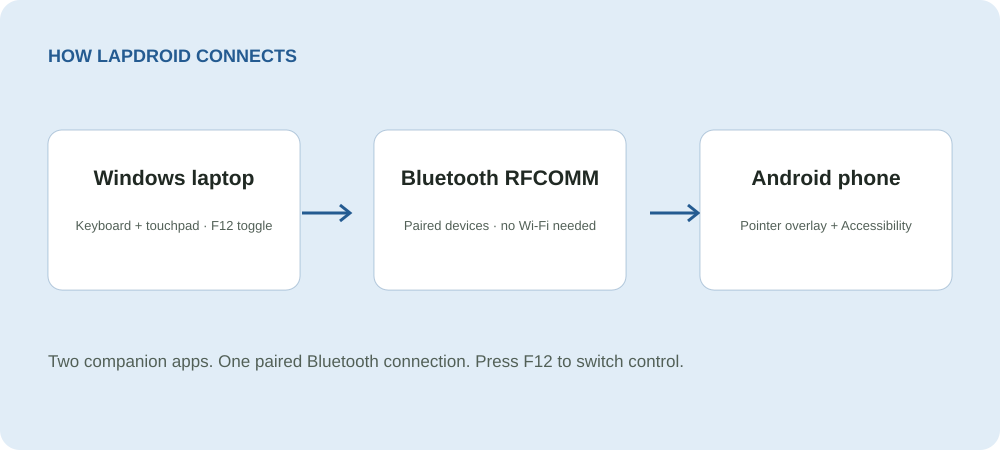

[**Website & downloads ↗**](https://silviuk.github.io/lapdroid/) · [Latest release](https://github.com/silviuk/lapdroid/releases/latest)

[](https://ko-fi.com/silviuvlasceanu)

# Lapdroid

Control your Android phone with your Windows laptop’s keyboard and touchpad. Type messages, tap, drag, and scroll over Bluetooth—no Wi-Fi needed.

**Windows + Android · Bluetooth**

## What you can do

- **Type and point from your laptop.** Use your laptop keyboard to type on the phone and your touchpad to move its on-screen pointer.
- **Use familiar mouse controls.** Left-click to tap, right-click to go Back, and middle-click to go Home. Use your touchpad to scroll through pages.
- **Connect over Bluetooth.** The two apps connect directly over Bluetooth RFCOMM. The Android app doesn’t ask for Internet access.

## How it works



Install the app on both devices, then press F12 to switch control.

## Get started

1. Download the Windows app and Android APK from the latest release, then pair the devices in Windows Bluetooth settings.
2. Open the Android app and grant Bluetooth, overlay, and Accessibility permissions. These let it show the pointer and send your taps, gestures, and keystrokes to other apps.
3. Start the Bluetooth server in the Windows app and connect your paired phone. Press F12 to control the phone, and press it again to return to Windows.

### Install with WinGet

```powershell
winget install --id silviuk.Lapdroid -e
```

Install the Android APK from the same [release page](https://github.com/silviuk/lapdroid/releases/latest).

## Before you start

Windows 10 or 11, Android 8.0 or later, Bluetooth on both devices, and both Lapdroid companion apps. Android overlay and Accessibility permissions are required for pointer display and input control.

If the pointer or typing doesn’t work, check the Android permissions first. Download the APK for your phone; the AAB is for store publishing. Bluetooth behavior can vary between devices.

## More information

See [build and distribution notes](docs/DEVELOPMENT.md) and the [store submission guides](docs/store-submissions/).

Something not working, or have a suggestion? [Open an issue](https://github.com/silviuk/lapdroid/issues). If you’d like to support my work, [you can leave a tip on Ko-fi](https://ko-fi.com/silviuvlasceanu).

© 2026 Silviu Vlasceanu. [License](LICENSE).
